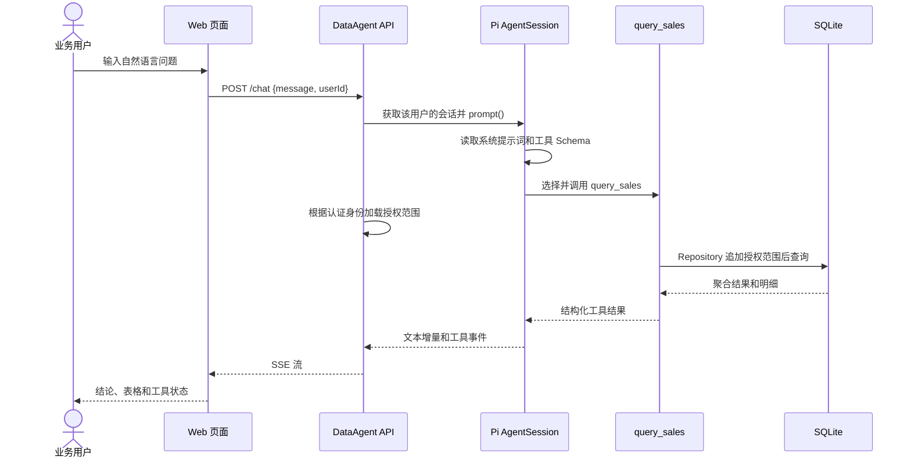

# DataAgent 产品设计文档

## 1. 产品定位

DataAgent 是面向企业业务人员和分析人员的自然语言销售数据分析助手。用户可以直接用中文描述问题，Agent 负责理解意图、选择受控的数据工具、返回可验证的统计结果，并以流式对话的方式解释结论。

它解决的问题不是“让模型自由回答数据问题”，而是把自然语言理解、结构化数据查询、权限控制和结果解释组合成一个可审计的业务分析流程：模型负责理解和表达，程序负责访问数据、执行计算和落实权限。

项目基于 Pi Coding Agent SDK 二次开发。Pi Agent 提供 AgentSession、ModelRuntime、ResourceLoader、Tool API、Extension API 和事件流；DataAgent 在此基础上补充企业销售领域的数据模型、权限模型、提示词组织、Web 服务和用户体验。

## 2. 目标与非目标

### 2.1 目标

1. 让用户用自然语言完成常见销售数据查询，例如“华东地区本月销售额是多少”。
2. 对所有数据访问施加服务端权限过滤，用户只能看到自己有权访问的数据。
3. 让工具调用、数据结果和最终回答可观察、可解释、可测试。
4. 使用流式响应降低等待感，实时展示 Agent 回答和工具执行状态。
5. 保持业务工具与 Agent Runtime 解耦，未来可以替换数据源、模型 Provider 或前端。

### 2.2 非目标

- 当前阶段不做通用 BI 平台、复杂报表编辑器和拖拽式仪表盘。
- 当前阶段不允许模型直接执行任意 SQL、Shell 或文件写入。
- 当前阶段不把模型生成的数字视为事实，所有数字必须来自受控工具返回的数据。
- 当前阶段的浏览器用户选择器仅用于演示，正式环境需要接入真实认证系统。

## 3. 目标用户

| 用户 | 典型问题 | 主要价值 | 数据范围 |
| --- | --- | --- | --- |
| 销售经理 | “华东笔记本电脑卖了多少？” | 快速查看本区域表现 | 本部门或指定区域 |
| 财务分析师 | “各地区本季度销售额和数量如何？” | 获取跨区域汇总和对比 | 全公司 |
| 业务负责人 | “最近销售额下降可能是什么原因？” | 获取事实、验证方法和行动建议 | 按授权范围 |

当前种子数据中包含 `u001`、`u002`、`u003` 三个示例用户，用户上下文和角色补充规则存储在 SQLite 中。

## 4. 典型用户旅程



## 5. 核心功能

### 5.1 自然语言销售查询（当前已实现）

支持按以下条件查询：

- 日期起止范围；
- 地区；
- 产品；
- 销售人员；
- 明细返回数量。

工具同时返回匹配记录数、销售额合计、数量合计和明细。明细采用标准 Markdown 表格输出，页面再渲染为 HTML 表格。

### 5.2 用户上下文与角色规则（当前已实现）

系统提示词由三部分组成：

1. 文件中的稳定人设、工作规则和输出格式；
2. 数据库中的用户身份、部门、角色和数据范围；
3. 数据库中的角色补充规则，例如财务角色更关注金额、数量、趋势和异常。

用户上下文中的角色和数据范围会帮助 Agent 理解场景，但它们不是安全边界。真正的权限链路是：服务端先根据身份从数据库读取授权配置，解析成受控的范围结构；工具闭包只持有这个服务端上下文；Repository 在每条查询中先追加授权条件，再追加模型提供的日期、地区、产品等业务条件。模型和浏览器都不能传入、覆盖或删除授权条件。

### 5.3 指标定义与期间比较（当前已实现）

数据库中的 `metric_definitions` 统一管理指标名称、公式、单位、时间字段、可用维度和版本。当前提供四个指标：

- `sales_amount`：销售额，`SUM(amount)`；
- `sales_quantity`：销售数量，`SUM(quantity)`；
- `order_count`：订单数，`COUNT(*)`；
- `avg_order_value`：平均订单金额，`SUM(amount) / COUNT(*)`。

`compare_periods` 工具接收当前期间、对比期间和指标标识，返回两个期间的指标值、绝对变化、变化率、记录数、指标口径和应用的数据权限范围。指标的计算逻辑由 Repository 的确定性代码执行，模型不能自行修改公式或拼接 SQL。

`breakdown_metric` 工具按指标定义允许的地区、产品或销售人员维度拆解两个期间的变化，返回分组变化率和贡献率。服务端同时复核期间变化率与分组变化合计，并在 `validation` 字段中返回通过或需要关注的状态。

数据已经扩展为 2024 年 1～12 月、3 个区域和 3 类产品，使用 `npm run generate:data` 可以重新生成同一份可复现的演示数据，使用 `npm run seed` 导入 SQLite。

### 5.3 工具安全门（当前已实现）

`limit-guard` 通过 Pi Agent 的 `tool_call` 扩展事件在工具执行前拦截非法或过大的 `limit`。模型会收到可理解的阻断原因并重新组织请求。

`scope-guard` 对三个业务工具统一拦截越权地区，Repository 在 SQL 前继续执行第二次权限校验。这样没有权限的地区不会被当作合法的空结果参与分析。

当前版本增加了一个轻量 Planner 和工具结果 Verifier：Planner 根据问题关键词生成有限的推荐步骤，Verifier 校验工具结构化字段、分组变化合计和证据字段覆盖率。每次工具调用生成 `calculationId` 并关联内存 Evidence，便于在一次分析请求中追溯数据来源。

### 5.4 流式对话（当前已实现）

服务端通过 SSE 推送以下事件：

- `text`：助手文本增量；
- `thinking`：思考增量（Provider 支持时）；
- `tool_start`：工具开始执行；
- `tool_end`：工具执行结果；
- `analysis_started`：本次请求的分析 ID；
- `plan_created`：本轮有限分析计划；
- `verification`：工具结果校验状态和证据覆盖率；
- `evidence_added`：与 `calculationId` 关联的结构化证据；
- `error`：请求错误；
- `done`：本轮结束。

前端会显示工具卡片、加载状态和可读的回答表格。

### 5.5 健康检查和工程脚本（当前已实现）

- `GET /health`：返回服务状态和当前模型；
- `npm run seed`：从 CSV 重建 SQLite 种子数据；
- `npm run check`：运行 TypeScript 类型检查；
- `npm test`：运行 Repository 权限测试。

## 6. 回答体验规范

Agent 的回答遵守以下格式：

1. 先给一到两句结论；
2. 明确说明查询条件和数据范围；
3. 多条明细使用 Markdown 表格；
4. 金额和数量使用千分位；
5. 区分工具查到的事实、模型推断和建议；
6. 数据不足时明确说明未知，不编造数字；
7. 对分析类问题给出验证方法和下一步行动。

页面展示层负责美化 Markdown 表格，但不会修改工具结果和数字内容。

## 7. 权限与信任边界

用户身份由服务端解析后创建或获取 AgentSession。当前演示版从请求体读取 `userId`，正式环境需要改为从登录态或签名 Token 中解析。

权限判断分为身份、策略和查询三层：

```text
认证层：从登录态或签名 Token 得到用户身份
    ↓
策略层：从 users/授权表解析成白名单 DataScope
    ↓
查询层：Repository 强制追加授权条件，并与业务过滤条件 AND 合并
    ↓
数据库层：只返回查询条件命中的数据
```

### 7.1 当前第一阶段的实际做法

- `users.data_scope` 当前只允许 `all` 或 `region:<地区>` 两种配置；`getUser()` 会先解析和校验，非法配置直接失败，不进入查询层；
- `DataAgentManager` 根据服务端加载的用户创建工具闭包，工具参数中没有 `data_scope` 字段，模型无法自行指定授权范围；
- `DataRepository.querySales()` 先构建授权条件，再追加日期、地区、产品和销售人员条件，所有值都使用参数绑定；
- 区域用户请求其他地区时，两个条件使用 `AND` 合并，结果为零，业务过滤器不能扩大范围；
- `scope-guard` 在 Pi `tool_call` 阶段拦截越权地区参数，阻止三个业务工具进入数据库；Repository 的预检查和 SQL 范围条件继续作为第二道防线；
- 全公司范围也必须来自服务端用户配置，不能由提示词中的角色名称推导；
- 查询结果返回 `appliedScope`，便于前端解释和审计，但它不能被用户请求修改。

当前浏览器的用户下拉框只是本地演示用的身份模拟器。因为没有接入登录系统，`POST /chat` 中的 `userId` 不能抵抗真实的冒用。正式环境必须从 OAuth/JWT/服务端 Session 解析身份，忽略请求体中的 `userId`，并在审计日志中记录认证主体和最终授权范围。这个边界不能靠提示词解决。

## 8. 数据策略

当前采用“CSV 作为导入源，SQLite 作为运行时数据库”的策略：

- CSV 便于提交、查看和复现演示数据；
- SQLite 负责索引、过滤、聚合和用户/提示配置；
- `metric_definitions` 负责统一指标口径和版本；
- `npm run seed` 保证数据库可以从干净状态重建；
- Repository 隔离数据库细节，未来可以切换到 PostgreSQL 或已有企业数据库。

## 9. 成功指标

后续评测可以围绕以下指标建立固定问题集：

- 查询正确率：工具结果与数据库真实结果一致；
- 权限正确率：越权问题不返回受限数据；
- 范围配置安全性：非法或未知 `data_scope` 默认拒绝；
- 身份可信度：生产请求不接受浏览器自报的用户身份；
- 工具选择率：需要查数据的问题能够调用正确工具；
- 首字节延迟：用户提交问题后多久看到第一段响应；
- 完成延迟：从提交到最终回答的时间；
- 结构化输出合规率：表格列数、金额格式和结论格式符合规范；
- 异常恢复率：工具错误或模型重试后仍能完成回答。

## 10. 产品路线

### 第一阶段：保守稳定版本（已完成）

- Pi Agent SDK 集成；
- 分层提示词；
- SQLite 数据层；
- 用户和角色提示配置；
- 服务端权限过滤；
- `data_scope` 白名单解析和失败关闭；
- 业务过滤条件不能扩大授权范围的测试；
- 指标定义读取和期间比较测试；
- 2024 年多月可复现销售种子数据；
- `query_sales` 工具；
- `compare_periods` 工具；
- `breakdown_metric` 工具；
- 期间变化率和维度分组合计的基础校验；
- 轻量 Planner、Tool Executor、Verifier 闭环；
- `calculationId`、Evidence 关联和分析记录查询接口；
- 安全扩展；
- 按用户会话；
- SSE Web 交互；
- 类型检查和基础测试。

### 第二阶段：多维业务分析能力

- 按地区、产品、月份分组聚合；
- 使用期间比较结果进行同比、环比和趋势解释；
- 销售异常检测；
- 图表数据工具；
- 查询条件和结果引用；
- 更丰富的日期与筛选表达。

### 第三阶段：生产化能力

- OAuth/JWT 登录；
- 基于角色和组织的数据授权；
- 持久化会话；
- 审计日志；
- Token、成本和延迟监控；
- 请求限流、超时、重试和断线恢复；
- PostgreSQL/企业数据仓库适配；
- Docker 和云部署。

## 11. 面试表达重点

这个项目可以从四个层面说明：

1. **Agent Runtime 二次开发**：不是只调用模型 API，而是使用 Pi 的 Session、Resource Loader、Tool 和 Extension 机制组合出完整运行时。
2. **可靠性**：模型只负责理解和表达，数据访问、计算和权限由确定性代码完成。
3. **安全性**：工具最小权限、工具调用前拦截、Repository 层强制数据范围。
4. **工程化**：流式服务、用户会话、数据库种子、类型检查、自动化测试和后续评测路线完整。
