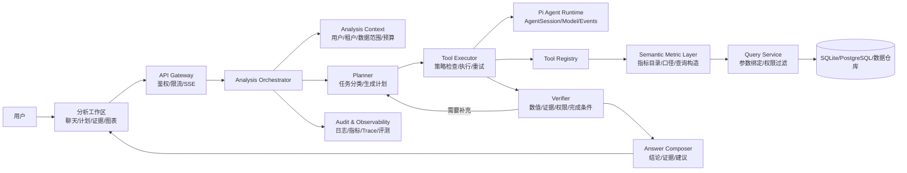

# DataAgent 目标技术架构

## 1. 架构目标

目标架构服务于“销售经营分析 Copilot”，重点解决四件事：

1. 让 Agent 能够规划和执行多步分析，而不是只调用一个查询工具；
2. 让模型只能使用受控的业务能力，不能绕过指标口径和数据权限；
3. 让每个结论都有工具结果、筛选条件和计算版本作为证据；
4. 让分析过程可以流式展示、限额、重试、评测和审计。

## 2. 逻辑架构



Pi Agent 是 Agent 运行时基础设施，业务分析能力放在应用层。这样可以保持 Pi SDK 可升级，避免把业务逻辑硬编码进框架或通过修改 SDK 来解决领域问题。

## 3. Pi Agent 二次开发边界

### 3.1 继续使用 SDK 提供的能力

- `ModelRuntime`：统一模型请求、流式文本和用量信息；
- `ResourceLoader`：加载系统提示词、指标说明和业务上下文；
- `AgentSession`：管理对话、工具调用、事件和取消；
- Tool API：注册结构化输入输出的业务工具；
- Extension API：注入策略、预算、审计和模型请求钩子；
- Event Stream：向前端推送计划、工具状态、文本增量和错误。

### 3.2 应用层自己实现的能力

- 分析任务分类和计划 schema；
- 指标语义层和查询构造器；
- 期间比较、贡献度、异常检测等确定性计算；
- 数据权限和字段脱敏；
- 验证器、证据索引和分析快照；
- 前端分析工作区、评测集和运营指标。

不建议为了增加业务能力去 fork Pi SDK。只有当 SDK 缺少稳定扩展点时，才应提交最小的框架适配层，并通过接口隔离业务代码。

## 4. 请求生命周期

一次“华东本月销售额为什么下降？”的请求按以下顺序执行：

1. **鉴权和建上下文**：解析用户、租户、角色、数据范围、请求 ID 和预算；
2. **问题分类**：识别是单指标查询、比较、诊断、排名还是报告任务；
3. **查指标目录**：确认“销售额”的公式、时间字段、默认粒度和可用维度；
4. **生成分析计划**：Planner 生成有限步骤、工具参数和停止条件；
5. **执行确定性工具**：Executor 为每次调用注入权限范围，记录开始、结束、输入摘要和结果摘要；
6. **验证中间结果**：Verifier 检查期间是否完整、分组之和是否合理、变化率是否正确、证据是否覆盖结论；
7. **受限重试或重规划**：发现缺证据时最多补充若干步骤，超过预算则停止并说明限制；
8. **组织答案**：Composer 只使用已验证结果生成结构化回答；
9. **流式返回**：前端依次收到计划、工具状态、证据卡片、文本增量和完成事件；
10. **保存审计**：保存分析 ID、指标版本、数据范围、工具调用、验证结果和回答版本。

## 5. Agent 编排模型

### 5.1 Planner

Planner 输出结构化计划，而不是直接输出自由文本：

```ts
type AnalysisPlan = {
  goal: string;
  metric?: string;
  period?: { start: string; end: string };
  steps: Array<{
    id: string;
    purpose: string;
    tool: string;
    input: Record<string, unknown>;
    dependsOn?: string[];
    expectedEvidence: string[];
  }>;
  stopConditions: string[];
};
```

计划必须限制最大步骤数、允许使用的工具和单步超时。工具结果可以影响后续参数，但不能让模型无限循环。

### 5.2 Tool Executor

Executor 是策略边界：

- 校验工具名称和 TypeBox schema；
- 注入用户数据范围和租户条件；
- 检查字段白名单、调用次数、超时和成本预算；
- 对只读查询做有限重试，对写操作要求显式确认；
- 为结果生成 `calculationId`，供证据和审计引用。

### 5.3 Verifier

Verifier 不重新生成答案，而是检查：

- 当前值、对比值和变化率的数学一致性；
- 分组值与总值的差异是否在可解释范围；
- 回答中的数字是否都能映射到工具结果；
- 工具结果是否落在用户允许的数据范围；
- 候选原因是否真的覆盖了足够的变化金额；
- 是否存在缺失字段、样本过小或数据延迟。

### 5.4 Composer

Composer 接收验证后的 `AnalysisPackage`，输出结构化答案：

```ts
type AnalysisAnswer = {
  summary: string;
  kpis: Array<{ label: string; value: number; unit: string; trend?: string }>;
  findings: Array<{ title: string; statement: string; evidenceIds: string[] }>;
  actions: Array<{ priority: "high" | "medium" | "low"; action: string; rationale: string }>;
  caveats: string[];
  followUps: string[];
};
```

前端根据字段渲染 KPI、表格、图表和证据引用，避免依赖 Markdown 空格排版。

## 6. 语义指标层

语义层是连接自然语言和数据查询的核心，不让模型直接拼接 SQL。

### 6.1 指标表

建议建立 `metric_definitions`：

| 字段 | 含义 |
| --- | --- |
| `metric_key` | 稳定的程序标识，如 `sales_amount` |
| `display_name` | 面向用户的名称 |
| `formula` | 受控公式或查询模板 |
| `time_field` | 使用订单日期、发货日期等 |
| `default_grain` | 日、周、月等 |
| `dimensions` | 允许拆解的维度 |
| `allowed_filters` | 允许的过滤字段和操作 |
| `owner` | 指标负责人 |
| `version` | 口径版本 |
| `updated_at` | 最近更新时间 |

指标目录可以先存 SQLite，生产环境迁移到 PostgreSQL。提示词可以帮助模型理解别名，但公式、范围和权限必须由服务端读取。

### 6.2 查询构造

`QueryService` 只接受已经解析和校验的请求，例如：

```ts
type QueryMetricRequest = {
  metricKey: string;
  period: { start: string; end: string };
  filters: Array<{ field: string; operator: "eq" | "in"; value: string | string[] }>;
  groupBy?: string[];
  dataScope: DataScope;
};
```

查询服务从指标定义生成参数化 SQL，自动追加 `tenant_id`、区域范围和字段权限条件。任何未在指标定义中出现的字段都应被拒绝。

## 7. 工具接口与证据模型

### 7.1 工具结果统一格式

```ts
type ToolResult<T> = {
  ok: boolean;
  data: T;
  calculationId: string;
  metricVersion?: string;
  period?: { start: string; end: string };
  filters: Record<string, unknown>;
  dataScope: string;
  source: string;
  warnings: string[];
};
```

### 7.2 重点工具

- `query_metric`：返回一个指标的值和基础统计；
- `compare_periods`：复用指标定义计算当前值、对比值、绝对变化和变化率；
- `breakdown_metric`：按照已允许的维度返回值、排名、贡献额和贡献率；
- `detect_anomalies`：基于历史基线或滚动窗口检测异常；
- `validate_hypothesis`：把候选维度和变化量关联，输出支持程度与证据；
- `get_evidence`：根据 `calculationId` 获取可展示的行列数据和来源。

所有结果都能通过 `calculationId` 找回。回答中不直接引用模型编造的数字，只引用这些计算记录。

## 8. 数据、权限与持久化

### 8.1 逻辑数据表

- `sales_facts`：销售事实；
- `dim_regions`、`dim_products`、`dim_salespeople`、`dim_customers`：维度；
- `metric_definitions`：指标目录；
- `users`、`roles`、`data_scopes`：身份和数据范围；
- `analysis_runs`：一次分析请求及其状态；
- `analysis_steps`：计划步骤和工具调用；
- `evidence_items`：工具结果摘要和可展示证据；
- `prompt_versions`：系统提示词和业务规则版本。

CSV 仍然用于初始化和批量导入，数据库承担查询、索引、权限条件、指标定义和审计。当前可以采用 SQLite 的单机实现；当需要并发、分享和定时任务时迁移到 PostgreSQL，查询接口保持不变。

### 8.2 权限流程

```text
请求用户 → AuthContext → PolicyEngine → QueryScope
       → Metric/Field 校验 → 参数化查询 → 脱敏结果
```

提示词中的角色描述、用户自己输入的“我可以看全部数据”都不能覆盖 `PolicyEngine` 的结果。

## 9. 会话、记忆和分析资产

- **短期上下文**：保存当前问题、计划、工具结果引用和追问状态；
- **分析快照**：保存指标版本、数据范围和最终回答，保证稍后打开时可复核；
- **用户偏好**：保存默认区域、常用指标和展示偏好，但不保存越权信息；
- **长期记忆**：仅保存明确允许的业务偏好或已确认的术语，不把任意模型输出当作事实。

本地阶段可用 SQLite 表维护；生产阶段用 Redis 存会话状态、PostgreSQL 存分析资产和审计记录。

## 10. 流式事件协议

前端通过 SSE 接收统一事件：

```ts
type AnalysisEvent =
  | { type: "analysis_started"; analysisId: string }
  | { type: "plan_created"; plan: AnalysisPlan }
  | { type: "tool_started"; stepId: string; tool: string }
  | { type: "tool_finished"; stepId: string; calculationId: string }
  | { type: "evidence_added"; evidence: EvidenceItem }
  | { type: "verification"; status: "passed" | "warning" | "failed"; message: string }
  | { type: "text_delta"; delta: string }
  | { type: "done"; answer: AnalysisAnswer }
  | { type: "error"; code: string; message: string };
```

`analysisId` 和 `stepId` 让浏览器可以在刷新或断线后恢复状态。流式文本只是展示层，最终答案以结构化 `done` 事件为准。

## 11. 前端和 API 边界

建议的 API：

- `POST /api/analysis`：创建分析并返回 `analysisId`；
- `GET /api/analysis/:id/events`：订阅 SSE 事件；
- `GET /api/analysis/:id`：读取分析快照；
- `GET /api/metrics`：查询可用指标和口径；
- `POST /api/analysis/:id/follow-up`：在原分析上下文中追问；
- `POST /api/analysis/:id/save`：保存或发布分析，需权限检查；
- `GET /api/health`：健康检查。

前端组件按事件渲染计划、工具卡片、证据表格、图表和回答。表格使用组件列配置和数字格式，不能把对齐责任交给模型返回的 Markdown。

## 12. 可靠性、安全和成本控制

- 工具白名单、最大计划步数、最大并发数和 Token 预算；
- 每个工具配置超时、有限重试和熔断；
- 所有数据库查询使用参数绑定，禁止拼接用户输入；
- 对客户、联系方式和成本字段做字段级脱敏；
- 记录提示词版本、模型版本、工具版本和数据快照；
- 对模型输出做 schema 校验和数字引用校验；
- 长耗时分析转为后台任务，SSE 只负责事件通知；
- 外部系统写操作采用确认令牌和幂等键。

## 13. 可观测性和评测

### 13.1 运行指标

- 请求数、成功率、P50/P95 延迟；
- 每个工具的成功率、耗时、重试次数和结果行数；
- 计划步数、模型调用次数和 Token 成本；
- 验证失败、权限拒绝和数据缺失次数；
- 用户追问率、保存率和反馈分布。

### 13.2 离线评测

建立包含真实业务问题的 Golden Questions：每题记录期望指标、时间范围、工具计划、关键数值、权限边界和允许的结论。评测至少覆盖：单指标、环比、维度归因、异常、数据缺失、越权请求和连续追问。

重点指标包括工具选择准确率、关键数字准确率、证据覆盖率、权限拒绝准确率和无依据结论率。模型文本的流畅度只能作为补充指标。

## 14. 部署演进

### 本地和作品集演示

```text
Node.js + Express + Pi Agent + SSE
SQLite + CSV seed
单进程 Analysis Orchestrator
```

### 团队试用

```text
Web UI → API/Agent Service → PostgreSQL
                         ↘ Redis（会话/任务）
                         ↘ Object Storage（报告）
```

### 生产环境

增加反向代理、认证服务、队列、定时任务、指标监控、集中日志、密钥管理、灰度发布和数据仓库适配。业务工具接口不应因为存储层替换而改变。

## 15. 当前版本到目标版本的迁移

| 当前实现 | 目标演进 |
| --- | --- |
| `query_sales` 一个查询工具 | `query_metric`、`compare_periods`、`breakdown_metric`、`detect_anomalies` 工具族 |
| 一次提示词直接调用工具 | Planner → Executor → Verifier → Composer |
| Markdown 文本和表格 | 结构化回答、证据对象和前端表格/图表 |
| 简单 `data_scope` | RBAC/ABAC、字段权限和服务端查询注入 |
| 进程内会话 | `analysis_runs`、分析快照和可恢复 SSE |
| 两个仓储测试 | Golden Questions、工具契约测试和权限/数字一致性评测 |
| CSV/SQLite 查询演示 | CSV 作为导入源，SQLite 起步，接口预留 PostgreSQL/数据仓库 |

这条迁移路径允许项目持续可运行：先在现有骨架上增加指标和工具，再逐步替换编排和界面，不需要一次性推倒重来。

## 16. 面试技术主线

项目可以围绕四个设计决策展开：

1. **为什么不是 Text-to-SQL**：任意 SQL 难以保证口径、权限和审计；
2. **为什么使用确定性工具**：模型负责选择和解释，程序负责计算和约束；
3. **为什么需要 Verifier**：多步分析中最危险的是数字看似合理但证据不完整；
4. **为什么要分析工作区**：Agent 的中间过程和证据需要被用户观察、复核和继续利用。

