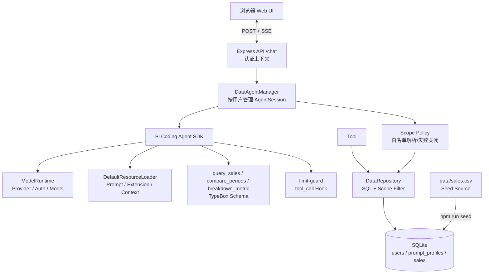
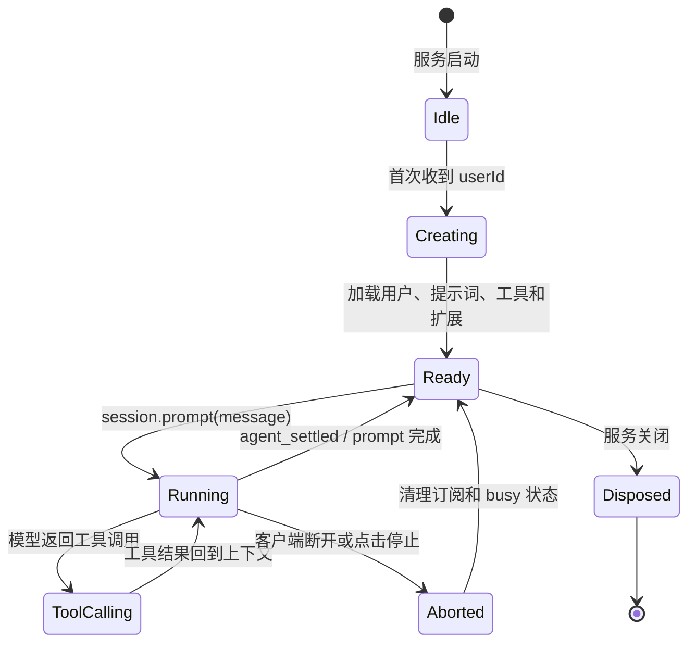

# DataAgent 技术架构文档

## 1. 架构目标

DataAgent 的技术设计围绕四个原则展开：

1. **模型和业务数据解耦**：模型通过工具访问数据，不能直接访问数据库。
2. **权限在服务端落地**：提示词只提供上下文，认证、策略解析和 Repository 查询条件共同形成真正的权限边界。
3. **运行时可扩展**：通过 Pi Agent 的 Resource Loader、Tool API 和 Extension API 添加能力，不修改 SDK 内核。
4. **传输层可替换**：当前使用 Express + SSE，未来可以接入 WebSocket、RPC 或其他前端。

## 2. 总体架构



## 3. 代码模块

| 模块 | 文件 | 责任 |
| --- | --- | --- |
| 配置 | `src/config.ts` | 项目根目录、端口、数据库路径和默认用户 |
| Agent 管理 | `src/agent/manager.ts` | 创建模型运行时、按用户缓存 AgentSession |
| 数据库 | `src/data/database.ts` | 打开 SQLite、创建 Schema、设置 WAL 和外键 |
| 数据访问 | `src/data/repository.ts` | 用户、提示配置、销售查询、指标查询和权限过滤 |
| 指标目录 | `src/data/metrics.ts` | 定义受控指标名称、公式、单位、维度和版本 |
| 分析规划 | `src/analysis/planner.ts` | 根据问题意图生成有限步骤和工具边界 |
| 分析执行 | `src/analysis/executor.ts` | 记录工具生命周期、生成 calculationId 并关联 Evidence |
| 结果验证 | `src/analysis/verifier.ts` | 校验结构化结果和证据字段覆盖率 |
| 分析类型 | `src/analysis/types.ts` | 定义计划、计算记录、验证结果和证据结构 |
| 提示词 | `src/prompts/loader.ts` | 加载 Markdown 提示词并拼装动态上下文 |
| 工具 | `src/tools/query-sales.ts` | TypeBox 参数约束和查询结果格式化 |
| 比较工具 | `src/tools/compare-periods.ts` | 期间比较参数校验、调用 Repository 和结果格式化 |
| 拆解工具 | `src/tools/breakdown-metric.ts` | 按白名单维度拆解指标变化并返回贡献率 |
| 结果校验 | `src/data/validation.ts` | 复核变化率和分组变化合计 |
| 扩展 | `src/extensions/limit-guard.ts`、`src/extensions/scope-guard.ts` | 在工具执行前拦截不合法参数和越权地区 |
| HTTP 服务 | `src/server.ts`、`src/http/sse.ts` | Express 路由、SSE 协议转换、取消和优雅退出 |
| 错误模型 | `src/errors.ts` | API 错误码、HTTP 状态和统一错误响应 |
| Web UI | `frontend/src/`、`frontend/vite.config.ts` | Vue 组件、SSE 状态管理和 Markdown 内容；构建产物输出到 `public/` |
| 种子脚本 | `src/scripts/seed-db.ts` | CSV 导入用户、角色、指标和销售数据 |
| 数据生成 | `src/scripts/generate-sales.ts` | 生成 2024 年多月可复现销售 CSV |
| 测试 | `tests/repository.test.ts` | 验证区域权限和全公司查询 |

## 4. Pi Agent SDK 集成

### 4.1 ModelRuntime

`ModelRuntime.create()` 读取 Pi Agent 的模型和认证配置，`getAvailable()` 返回当前可用模型。应用只选择可用模型，不在业务代码中硬编码 API Key。

```ts
const modelRuntime = await ModelRuntime.create();
const model = (await modelRuntime.getAvailable())[0];
```

生产环境可以在这一层增加模型选择策略，例如按任务复杂度、成本、延迟或 Provider 健康状态选择模型。

### 4.2 DefaultResourceLoader

每个用户 Session 使用一个包含用户上下文的 ResourceLoader：

```ts
const loader = new DefaultResourceLoader({
  cwd: PROJECT_ROOT,
  agentDir: getAgentDir(),
  systemPromptOverride: () => systemPrompt,
  appendSystemPromptOverride: () => [],
  extensionFactories: [/* tool + guard */],
});
```

静态提示词来自 `prompts/analyst/*.md`，动态内容来自数据库。`reload()` 确保覆盖配置进入 Agent Runtime。

### 4.3 最小工具权限

创建 Session 时显式指定：

```ts
tools: ["query_sales", "compare_periods", "breakdown_metric"]
```

当前实际配置为 `tools: ["query_sales", "compare_periods", "breakdown_metric"]`。这样产品 Agent 不会继承默认的 `read`、`bash`、`edit` 和 `write` 工具。权限策略由 Runtime 配置保证，而不是依赖模型遵守提示词。

### 4.4 Tool API

三个业务工具都使用 TypeBox 定义参数 Schema。参数先由 SDK 校验，再进入 Repository。工具只返回与业务相关的结构化结果，模型看不到数据库连接和 SQL 细节。

```text
服务端认证并加载用户
  ↓
解析白名单 DataScope
  ↓
模型理解问题
  ↓
生成 query_sales 参数
  ↓
Pi Agent 校验 Schema
  ↓
Extension tool_call 安全检查
  ↓
Repository 先追加授权条件，再追加业务过滤条件
  ↓
SQLite 执行查询
```

`compare_periods` 的执行链路是：

```text
模型选择 metricKey 和两个日期期间
  ↓
Schema 校验指标标识和日期格式
  ↓
Repository 读取 metric_definitions
  ↓
Repository 注入用户授权范围并分别聚合两个期间
  ↓
确定性代码计算绝对变化和变化率
  ↓
返回指标口径、结果和数据范围
```

指标定义表中的公式用于展示和版本追踪，实际聚合由受控的 `MetricKey` 分支执行，避免把数据库中的字符串当作任意 SQL 执行。

工具的 `details` 字段保留结构化结果，`content` 字段提供模型可读文本。后续可以让前端使用 `details` 直接绘制图表，而不需要解析自然语言。

`breakdown_metric` 先读取指标定义允许的维度，再分别聚合当前期间和对比期间，计算分组变化和贡献率。`validation.ts` 会复核变化率以及分组变化合计，结果以 `validation` 字段返回。

当前版本通过 `AnalysisStore` 保存一次请求的计划、计算记录和 Evidence。Pi 的工具生命周期由 `ToolExecutor` 接入，在 `tool_result` 阶段追加 `calculationId`、验证结果和 `evidenceIds`，形成最小的 Planner → Tool Executor → Verifier 闭环。

### 4.5 Extension API

`limit-guard` 使用 `pi.on("tool_call")` 在工具执行前检查 `limit`：

- 参数不是整数时阻断；
- 小于 1 时阻断；
- 大于最大值时阻断；
- 返回 `reason` 给 Agent，让模型根据原因重新规划。

这个机制可以继续扩展成：敏感字段拦截、成本预算、租户级限流、审计日志和人工确认。

`scope-guard` 同样监听 `tool_call`。当区域用户的工具参数包含其他地区时，Pi Agent 在工具执行前直接返回阻断原因，避免无权限请求进入 Repository。Repository 的 `assertRegionAllowed()` 和 SQL 授权条件仍然保留，防止业务代码绕过扩展直接调用数据层。

## 5. 用户 Session 生命周期



`DataAgentManager` 使用 `Map<userId, ManagedSession>` 管理用户会话，并使用 `Set<userId>` 防止同一用户同时提交两轮 Prompt。不同用户拥有不同的 AgentSession，因此不会共享对话历史或动态系统提示词。

正式环境还需要：

- 把 Session 元数据和消息持久化；
- 设置空闲 Session 的过期时间；
- 处理多实例部署时的会话路由或共享存储。

## 6. 数据模型

### 6.1 users

| 字段 | 类型 | 说明 |
| --- | --- | --- |
| `id` | TEXT | 用户唯一标识 |
| `name` | TEXT | 显示姓名 |
| `department` | TEXT | 部门 |
| `role` | TEXT | 业务角色 |
| `data_scope` | TEXT | 当前阶段只允许 `all` 或 `region:华东`，由服务端解析 |
| `prompt_profile` | TEXT | 角色提示配置名 |
| `active` | INTEGER | 是否启用 |

### 6.2 prompt_profiles

角色级的补充分析规则。它与用户身份分开，避免把相同的角色规则复制到每个用户记录中。

### 6.3 sales

销售事实表包含日期、产品、地区、销售额、数量和销售人员。日期、地区和产品建立索引，支持常用过滤。

### 6.4 metric_definitions

| 字段 | 类型 | 说明 |
| --- | --- | --- |
| `metric_key` | TEXT | 稳定指标标识 |
| `display_name` | TEXT | 中文显示名称 |
| `description` | TEXT | 指标业务含义 |
| `formula` | TEXT | 展示用公式，例如 `SUM(amount)` |
| `unit` | TEXT | 元、件、笔或元/笔 |
| `time_field` | TEXT | 当前为 `sale_date` |
| `dimensions_json` | TEXT | 允许的拆解维度 |
| `version` | INTEGER | 指标口径版本 |
| `active` | INTEGER | 是否启用 |

### 6.5 权限查询

权限不能由角色提示词、模型参数或浏览器选择器决定。当前第一阶段采用“认证用户 → 数据库授权配置 → 受控 DataScope → Repository 条件”的链路。

`getUser()` 对 `data_scope` 做白名单解析：

```text
all              → { kind: "all" }
region:华东       → { kind: "region", region: "华东" }
region:*          → 拒绝
随意字符串        → 拒绝
```

Repository 先构建授权条件，再追加用户请求中的业务过滤条件：

```sql
WHERE region = :authorized_region
  AND sale_date >= :date_from
  AND product = :product
```

其中 `:authorized_region` 来自服务端解析的用户上下文，`date_from` 和 `product` 才是模型可以通过 Schema 提供的业务条件。即使模型请求华南，华东用户最终执行的仍然是 `region = '华东' AND region = '华南'`，返回零行。所有参数使用绑定变量，范围值不会拼接进 SQL。

当前 SQLite 没有 PostgreSQL 那样的原生 Row Level Security，因此 Repository 是本地阶段的强制边界。生产环境建议继续保留 Repository 的策略检查，同时在 PostgreSQL 使用数据库角色、RLS/View 或独立查询服务做第二道边界。这样即使某个业务代码遗漏了过滤条件，数据库连接本身也不能读取越权行。

正式系统还应将单个字符串升级为授权关系表，例如 `user_scope_bindings(user_id, scope_type, scope_value, effect, expires_at)`，并在请求开始时生成不可变的 `AuthContext`。角色用于授予能力，具体数据范围来自用户与组织的授权绑定；不能仅由角色名称或提示词推导。

## 7. SSE 传输设计

当前使用单请求模式：浏览器通过 POST 发送问题，HTTP 响应本身就是 SSE 流。这样消息和响应天然绑定，不需要额外的 `sessionId` 收流接口。

事件格式：

```text
data: {"type":"text","data":{"delta":"..."}}\n\n
```

服务端只把前端关心的事件翻译成 SSE，底层 Pi Agent 的内部生命周期事件不会全部暴露给浏览器。客户端通过 `ReadableStream.getReader()` 按 `\n\n` 分割事件，并更新对应的 UI 卡片。

连接处理要点：

- 使用 `req.on("aborted")` 检测请求体异常中断；
- 使用 `res.on("close")` 检测响应连接断开；
- 正常 `res.end()` 前先标记 `settled`，避免误 abort；
- `finally` 中始终清理订阅和用户 busy 状态；
- 客户端停止请求时，服务端调用 `session.abort()`。

生产环境可增加心跳、断线重连、事件序号和代理缓冲配置。

## 8. 错误处理策略

| 场景 | 当前行为 | 后续增强 |
| --- | --- | --- |
| 用户不存在 | 返回 404 JSON | 接入认证和统一错误码 |
| 同一用户重复提交 | 返回 429 | 增加队列或 steering/follow-up 策略 |
| 工具参数非法 | Schema 或 Extension 阻断 | 记录审计事件 |
| 数据库查询错误 | 返回 Agent error SSE | 增加重试和降级 |
| 客户端断开 | abort Session | 增加取消原因和指标 |
| 模型无可用配置 | 启动失败 | 增加健康检查和多模型 fallback |

## 9. 测试与评测

当前自动化验证包含：

- TypeScript 严格类型检查；
- 区域用户只能查询授权区域；
- 全公司用户能够查询全部区域；
- 区域用户传入其他地区过滤条件时仍然只能得到授权区域；
- 非法 `data_scope` 配置失败关闭；
- Agent 层越权地区参数在工具执行前被阻断；
- 指标目录包含四个受控指标；
- 华东用户进行期间比较时，两个期间都只聚合华东数据；
- 按产品拆解期间变化时，分组变化合计通过基础校验；
- Planner 能为普通查询、期间比较和原因拆解生成有限步骤；
- 工具结果包含 `calculationId`，并能关联内存 Evidence；
- Verifier 能返回证据字段覆盖率和校验警告；
- 变化率使用确定性代码计算，不能由模型直接生成；
- Session 只启用受控的 `query_sales`、`compare_periods` 和 `breakdown_metric`。

当前已经建立三层基础测试中的业务单元和分析闭环测试，并补充了 SSE 协议测试。后续应继续增加 HTTP 集成和前端事件测试：

1. **单元测试**：Repository、过滤器、提示词拼装和 SSE 翻译。
2. **集成测试**：SQLite、AgentSession、工具调用和扩展拦截协作。
3. **离线评测**：固定问题、期望过滤条件、期望聚合结果和权限结果。

离线评测不应只比较最终字符串，而应比较：

- 是否调用正确工具；
- 工具参数是否正确；
- 返回数字是否正确；
- 是否发生越权；
- 回答是否说明数据范围和不确定性。

## 10. 安全设计

- 不把 API Key 放入项目代码，使用 Pi Agent 的运行时认证配置。
- 产品 Agent 使用工具最小权限，不暴露 Shell 和文件修改工具。
- 不允许模型直接生成并执行任意 SQL。
- 所有查询使用参数绑定，避免拼接用户输入到 SQL。
- 对工具返回的明细数量设置上限。
- 数据权限在 Repository 层强制执行。
- `data_scope` 只接受白名单格式，未知格式失败关闭。
- 工具闭包使用服务端加载的用户上下文，工具 Schema 不暴露范围参数。
- 当前演示允许通过 `userId` 切换示例用户；正式环境必须使用认证 Session/JWT，并拒绝客户端自报身份。
- 生产数据库增加 RLS、View 或独立查询服务作为纵深防御。
- 正式环境从认证 Token 获取用户身份，不信任浏览器任意提交的 `userId`。
- 对提示词配置、工具调用和数据查询记录审计信息。

## 11. 可观测性规划

每一轮 Agent 运行建议记录以下字段：

```text
request_id
user_id
session_id
model_provider / model_id
prompt_length
tool_name / tool_args_hash
tool_duration_ms
tool_is_error
first_token_latency_ms
total_duration_ms
input_tokens / output_tokens
abort_reason
```

Pi Agent 的事件机制适合在 `agent_start`、`tool_call`、`tool_execution_end`、`message_update` 和 `agent_settled` 等节点埋点。生产环境中日志应脱敏，避免记录完整的用户敏感数据。

## 12. 部署演进

### 当前本地模式

```text
Node.js 24
  ├─ Express
  ├─ Pi Coding Agent SDK
  ├─ SQLite
  └─ 静态 Web 页面
```

### 单机部署

```text
反向代理
  ↓ SSE
Node.js DataAgent
  ├─ PostgreSQL / SQLite
  ├─ 日志和指标
  └─ Provider API
```

### 多实例部署

需要增加：

- PostgreSQL 或数据仓库；
- Redis/共享会话存储；
- 负载均衡和 SSE 长连接配置；
- 统一认证和租户上下文；
- Provider 超时、重试和熔断策略。

## 13. 技术取舍

### 为什么先用 SQLite

SQLite 让项目可以零外部依赖启动，适合学习、演示和简历项目初版。Repository 抽象隔离了数据库实现，后续可替换为 PostgreSQL。

### 为什么使用工具而不是让模型写 SQL

工具可以限制参数、统一权限、做类型校验和记录审计。让模型自由写 SQL 会增加越权、语法错误和不可控成本。

### 为什么使用 Extension 而不是把安全判断写在工具里

工具负责业务查询，Extension 负责横切约束。这样限流、审计、确认和策略检查可以复用于多个工具，体现 Pi Agent 的扩展式设计。

### 为什么使用 SSE

当前交互是服务端单向推送文本和工具事件，SSE 比 WebSocket 更简单，浏览器端可以直接通过 Fetch Stream 读取。未来如果需要双向实时控制，再考虑 WebSocket 或 RPC。

## 14. 面试讲解主线

建议按照以下顺序讲项目：

1. 用户用自然语言提出销售分析问题；
2. 服务端根据认证身份获取用户上下文和权限；
3. Pi AgentSession 加载分层提示词和受控工具；
4. 模型决定是否调用 `query_sales`；
5. `tool_call` Extension 做参数安全检查；
6. Repository 在 SQL 层追加授权范围；
7. SQLite 返回聚合和明细；
8. Agent 将结果解释成结论和 Markdown 表格；
9. Express 把事件转换为 SSE；
10. 浏览器实时渲染文本、工具卡片和表格。

这条链路能够同时体现 Prompt Engineering、Tool Calling、Agent Runtime 扩展、权限设计、数据工程、流式服务和测试评测，而不是只展示一个简单的模型问答页面。
